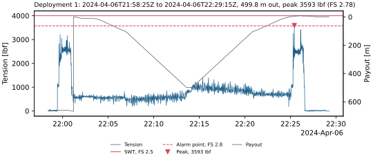

# Example outputs

What winch-data-processing writes, for one real cast: **RR2403**, R/V Roger Revelle's hydro winch
(Markey DESH-5), its LCI-90i logged by OpenRVDAS at 20 Hz, on 2024-04-06: the counter at a stale
664.5 m until zeroed, a cast to 500 m, and the recovery (R2R fileset 160178, cut to 50 minutes in
`tests/data/`). The cruise is R2R's; the tension member is **assumed**, since R2R doesn't record
it: a typical 0.322 in. EM cable at FS 2.5 ([`RR2403_hydro.toml`](RR2403_hydro.toml)). The
sheaves and monitoring system aren't known either, so their checks warn; and the cast's peak,
3,593 lbf, went past Table A.8.2's alarm point (3,571 lbf, FS 2.8) for 0.1 s, so that check warns
too.

| Directory | Command | Files |
|---|---|---|
| [`run/`](run/) | `run`, with `--wire-record` | [the PDF report](run/RR2403_hydro_report.pdf), [the wire log](run/RR2403_hydro_wire_log.csv), [the checks](run/RR2403_hydro_checks.csv), [the timeline](run/RR2403_hydro_plots/timeline.svg) and [the cast](run/RR2403_hydro_plots/cast_001.svg) |
| [`wire-record/`](wire-record/) | `wire-record report`, on the record `run` merged the cast into | [the wire record's report](wire-record/ASSUMED-HYDRO_wire_record.pdf), and the record's files: [`deployments.csv`](wire-record/deployments.csv), [`tension_member.toml`](wire-record/tension_member.toml) and [`events.toml`](wire-record/events.toml) |

The wire record's `events.toml` is **illustrative**: made-up spooling, break test, lubrication,
cutback, termination and resistance test, dated before the cruise, to show the report's
maintenance and events. They aren't Revelle's, nor any real tension member's. The illustrative
break test is the one the cruise's checks use (`--wire-record`), so its break test interval
passes.

Left out: the other two figures and the notebook (which holds local paths); every figure is in
the PDF.



## Rebuilding them

From a clone, after a change to the reports, from the repository's root (so the PDF names the
data by its relative path, `data/RR2403_cast`). The cast is committed in `tests/data/`:

```bash
rm -rf data/RR2403_cast
mkdir -p data/RR2403_cast
xz -dc tests/data/RR2403_winch_lci90i_hydro-2024-04-06_cast.txt.xz \
    > data/RR2403_cast/RR2403_winch_lci90i_hydro-2024-04-06_cast.txt
rm -rf output/examples
mkdir -p output/examples/records/ASSUMED-HYDRO
cp docs/examples/wire-record/events.toml output/examples/records/ASSUMED-HYDRO/
uv run winch-data-processing run data/RR2403_cast -c docs/examples/RR2403_hydro.toml \
    -o output/examples/run --wire-record output/examples/records
uv run winch-data-processing wire-record report output/examples/records/ASSUMED-HYDRO
cp output/examples/run/RR2403_hydro_{report.pdf,wire_log.csv,checks.csv} docs/examples/run/
cp output/examples/run/RR2403_hydro_plots/{timeline,cast_001}.svg docs/examples/run/RR2403_hydro_plots/
cp output/examples/records/ASSUMED-HYDRO/{deployments.csv,tension_member.toml,ASSUMED-HYDRO_wire_record.pdf} \
    docs/examples/wire-record/
```

Every output is identical run to run, so a rebuild changes only what the change to the reports
changed. `tests/test_examples.py` rebuilds the text outputs (the wire log, the checks,
`deployments.csv` and `tension_member.toml`) and fails when they differ from these.
